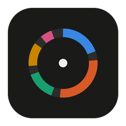
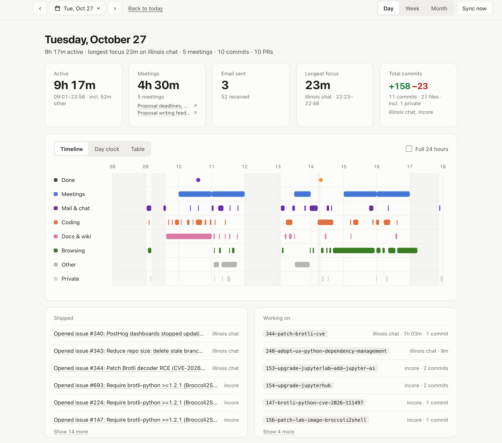
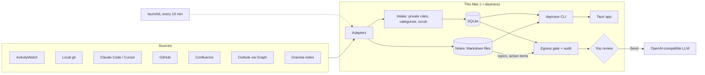

<p align="center">
  
</p>

<h1 align="center">daytrace</h1>

<p align="center">
  <em>"Where did my Wednesday go?"</em><br>
  A local-first macOS app that reconstructs your workday from the traces you already leave behind.
</p>

<p align="center">
  
</p>

daytrace reads your calendar, mail metadata, commits, pull requests, wiki edits, meeting notes, coding-agent sessions
and focused windows, and lays the day out on one timeline: how long you were active, where your meetings fell, your
longest stretch of focus and what ended it, and what you shipped. Week and month views add up the same numbers.
If you want, an LLM can write a short look back at your week, but only from a request you reviewed first.

Everything is stored on your Mac. Nothing leaves it except that reviewed request.

## Features

- **Day view.** A timeline (or 24-hour clock, or table) with one lane per kind of activity: meetings, mail and chat,
  coding, review, docs and wiki, browsing. Overlap is normal, so totals are unions of time, not sums.
- **Time per project**, worked out from repo folders, GitHub repos and title patterns you define. Inferred time
  (an agent session running while you look at its editor, say) is shown apart from time that's known.
- **Longest focus**, with what ended it: a meeting, mail or chat, a break, or a switch to something else.
- **What shipped**: PRs, issues, releases and wiki edits, plus the branches you worked on and your commit totals.
- **Meeting notes** from Granola, attached to the calendar meeting they were taken in.
- **Week and month views**, with an optional LLM summary that points out open loops, recurring topics and
  patterns, and drafts a todo list for the next week.
- **Menu-bar app and a floating day clock**, with background sync every 10 minutes.

## Sources

Every source is optional.

| Source | What daytrace keeps |
|---|---|
| [ActivityWatch](https://activitywatch.net/) | focused app and window title, time away from the keyboard |
| Local git | your own commits: subject, branch, files and lines changed |
| Claude Code, Cursor | when agent sessions ran and in which folder, never the prompts |
| GitHub | PRs, reviews, issues, comments, pushes and releases from your activity feed |
| Confluence (Data Center) | pages and blog posts you created or edited, your comments |
| Outlook (Microsoft Graph) | meeting subjects and times; sent and received mail subjects, times and the other side's domains |
| [Granola](https://www.granola.ai/) | your meeting notes, copied as Markdown files |

## Quick start

macOS only. You need [uv](https://docs.astral.sh/uv/getting-started/installation/) and git.

```bash
uv tool install --editable .     # puts `daytrace` on your PATH
daytrace init                    # creates ~/.daytrace; tracking starts today
daytrace sync                    # collect now
daytrace today                   # look at today in the terminal
daytrace agent install           # sync every 10 minutes in the background
```

Then connect the sources you use and, optionally, build the desktop app. See [docs/setup.md](docs/setup.md).

## Privacy

- **Everything stays on your Mac** in `~/.daytrace/`. No telemetry, no cloud store. daytrace only reads from your
  sources, with one exception: once ActivityWatch's raw events are stored, daytrace deletes them from
  ActivityWatch after 7 days (`[retention]` in `rules.toml`; set it to 0 to keep them).
- **Private means excluded.** Anything matching `[private]` in `~/.daytrace/rules.toml` (apps, title patterns,
  folders, browser profiles), and any Outlook meeting marked private, is stored as a bare time block: no app,
  title, URL or project. Incognito windows aren't stored at all.
- **Minimal metadata.** Mail and meetings keep subjects, times and counts, never bodies or addresses. Granola
  notes are copied as Markdown files to `~/.daytrace/notes/`, never into the database. Claude Code and Cursor keep
  session timing, never prompts. Titles are scrubbed of tokens and keys, and URLs lose their query strings.
- **The LLM sees only what you approve.** Week and month summaries are opt-in. daytrace builds the request
  (scrubbed, people's names removed, private time as a single total), saves it to `~/.daytrace/audit/`, and shows
  it to you. You can take anything out; nothing is sent until you press **Send**, and then only once.
- **You can delete.** `daytrace forget START END` deletes the events in a date range (stored summaries, audit files
  and notes stay); `rm -rf ~/.daytrace` removes everything.

## How it works



Each source has an adapter that reads new traces since its last sync. Intake applies your private rules, assigns a
category and project, and scrubs secrets before anything is stored. Stats are computed when you look, never
stored. The desktop app shells out to the CLI, so all the logic lives in Python. Details are in
[docs/design.md](docs/design.md).

| Part | Choice |
|---|---|
| Collector and CLI | Python 3.12, standard library only, [uv](https://docs.astral.sh/uv/) |
| Storage | SQLite |
| Scheduling | [launchd](https://www.launchd.info/) agent |
| Desktop | [Tauri 2](https://v2.tauri.app/) + React + [D3](https://d3js.org/), built with Vite |
| LLM | any OpenAI-compatible endpoint, such as [OpenRouter](https://openrouter.ai/) |
| Window tracking | [ActivityWatch](https://activitywatch.net/) |
| Outlook | [Microsoft Graph](https://learn.microsoft.com/graph/overview), device-code sign-in |
| Meeting notes | [Granola's MCP server](https://docs.granola.ai/help-center/sharing/integrations/mcp), device-code sign-in |

## Development

```bash
uv sync && uv run pytest
npm --prefix app run dev         # UI-only preview at http://localhost:1420
```

The browser preview reads fixtures from `app/dev/` (gitignored), made from your own data:

```bash
daytrace day --json > app/dev/dev-day.json
daytrace period week > app/dev/dev-week.json      # and month > dev-month.json
daytrace note NOTE_ID > app/dev/dev-note.json     # shown for any note
```

Add `?window=pill` to the URL for the floating clock.

## License

[MIT](LICENSE)

