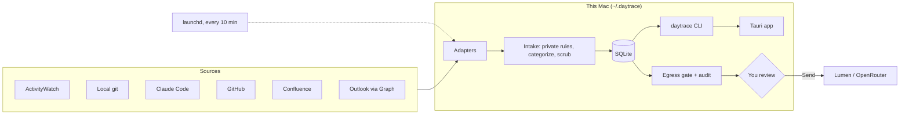

# daytrace

A life, in little traces. A local-first recorder that reconstructs what your workday looked like from the
traces you already leave: meetings, mail, commits, PRs, wiki edits, focused apps.

- **Setup:** [docs/setup.md](docs/setup.md) — install, sources, Outlook, Lumen/OpenRouter, desktop app
- **Design:** [docs/design.md](docs/design.md)

## Architecture



## Technology

| Part | Choice |
|---|---|
| Collector & CLI | Python 3.12, stdlib only, [uv](https://docs.astral.sh/uv/) |
| Storage | SQLite |
| Scheduling | [launchd](https://www.launchd.info/) agent |
| Desktop | [Tauri 2](https://v2.tauri.app/) + React + [D3](https://d3js.org/), built with Vite |
| LLM | any OpenAI-compatible endpoint (Lumen, [OpenRouter](https://openrouter.ai/)) |
| Window tracking | [ActivityWatch](https://activitywatch.net/) |
| Outlook | [Microsoft Graph](https://learn.microsoft.com/graph/overview), device-code sign-in |

## Privacy

- **Everything stays on your Mac** in `~/.daytrace/`. No telemetry, no cloud store. Sources are read-only.
- **Private is excluded.** Anything matching `[private]` in `~/.daytrace/rules.toml` (apps, title patterns,
  folders, browser profiles) is stored as a bare time block: no app, title, URL or project.
  Incognito windows are not stored at all.
- **Minimal metadata.** Mail and meetings keep subjects, times and counts, never bodies or addresses. Claude Code
  keeps session timing, never prompts. Titles are scrubbed of tokens and keys.
- **The LLM sees only what you approve.** Week/month summaries are opt-in. daytrace builds the request
  (scrubbed, people's names removed, private time as one total), saves it to `~/.daytrace/audit/`, and shows it
  to you. You can remove anything; nothing is sent until you press **Send**, and only once.
- **You can delete.** `daytrace forget START END` removes a date range; `rm -rf ~/.daytrace` removes everything.

## Development

```bash
uv sync && uv run pytest
npm --prefix app run dev         # UI-only preview at http://localhost:1420 (fixtures in app/dev/)
```

UI preview fixtures: `daytrace day --json > app/dev/dev-day.json`, `daytrace period week > app/dev/dev-week.json`
(same for `month`). Add `?window=pill` for the floating clock.
